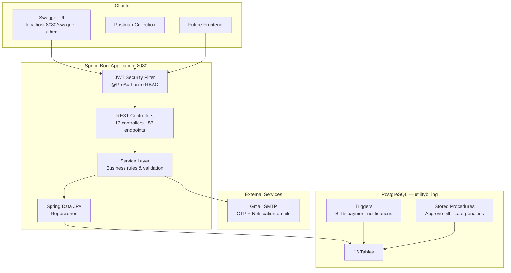
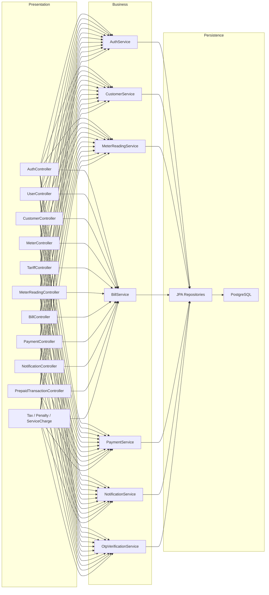
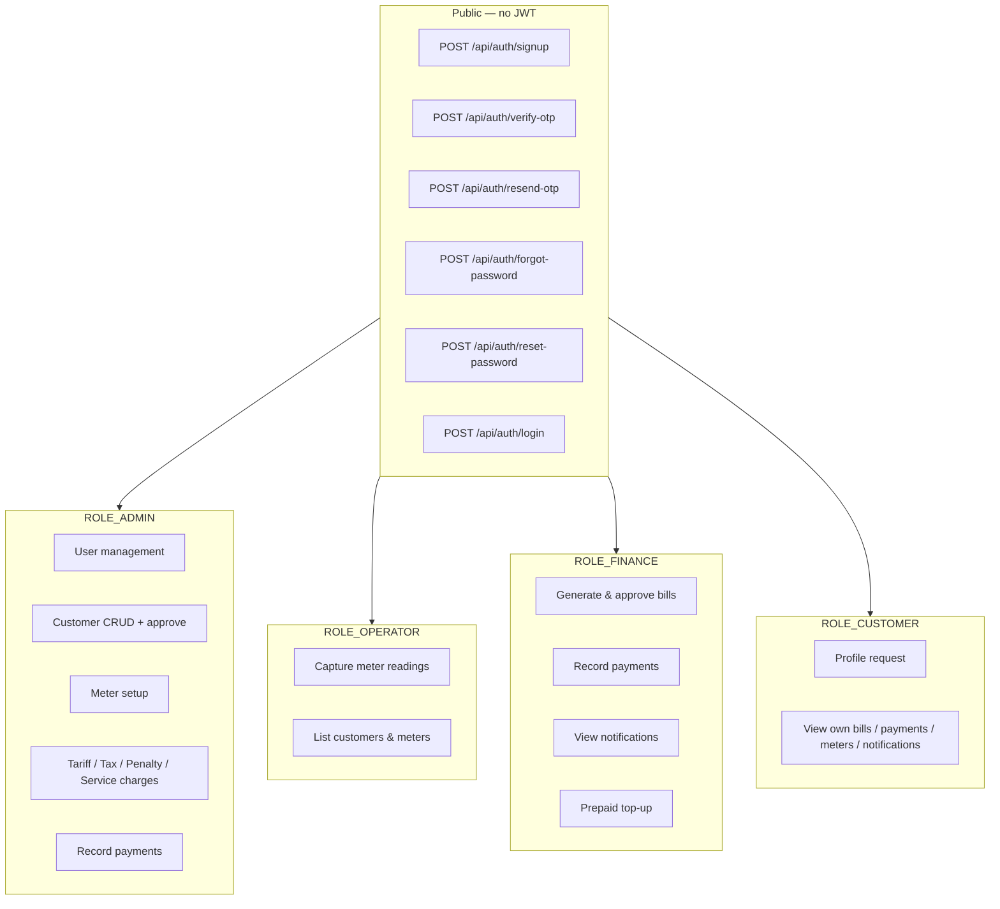
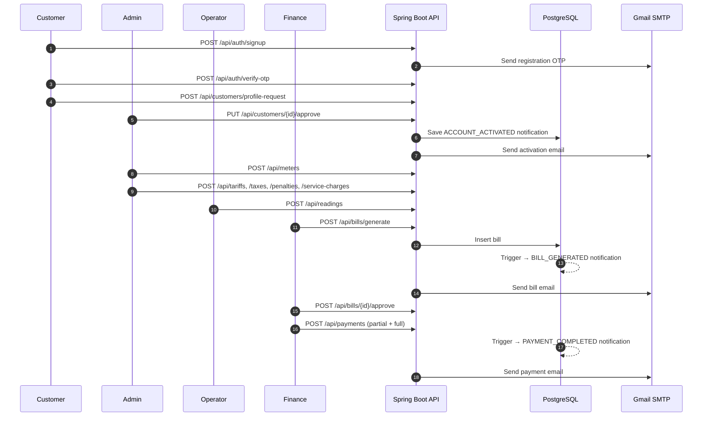
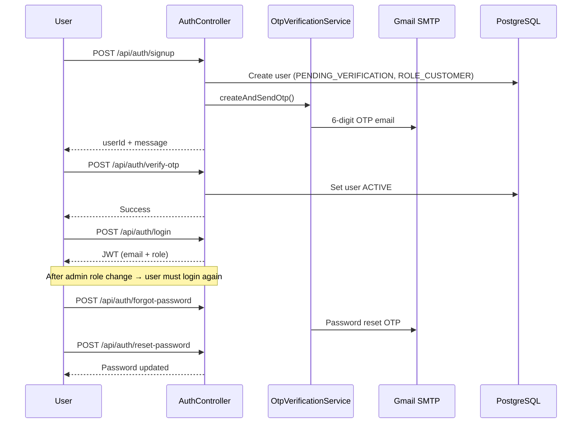
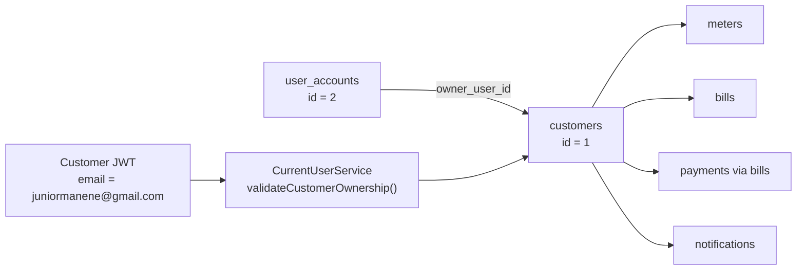
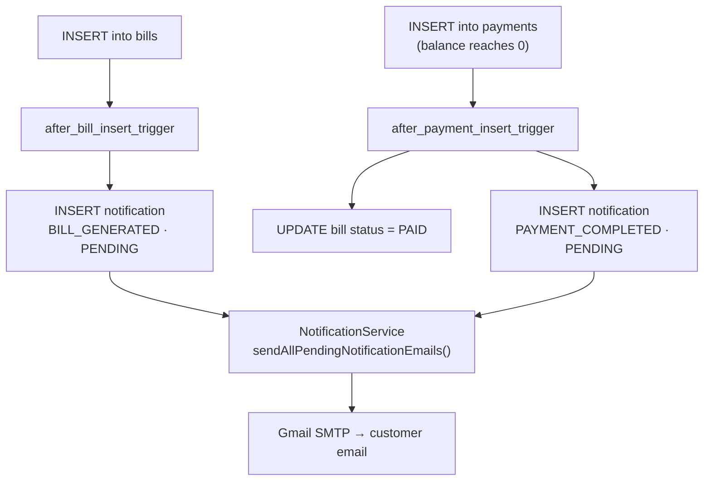
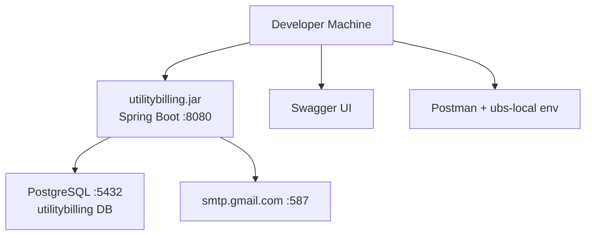

# Utility Billing System — High-Level Architecture

Spring Boot backend for WASAC/REG integrated utility billing.  
Stack: **Spring Boot · Spring Security (JWT) · Spring Data JPA · PostgreSQL · Gmail SMTP**

---

## 1. System Context

---

## 2. Layered Architecture

---

## 3. Role-Based Access Control

| Role | Key permissions |
|------|-----------------|
| **ROLE_ADMIN** | Users, roles, customers, meters, billing config, payments |
| **ROLE_OPERATOR** | Meter readings, list customers/meters |
| **ROLE_FINANCE** | Bills, payments, notifications, prepaid |
| **ROLE_CUSTOMER** | Own data only (linked via `customers.owner_user_id`) |

---

## 4. End-to-End Billing Flow

---

## 5. Authentication Flow

---

## 6. Customer Data Isolation

Customers can only access records where `customers.owner_user_id` matches their logged-in `user_accounts.id`.

---

## 7. Database Routines Integration

---

## 8. API Module Map

| # | Swagger Section | Base Path | Roles |
|---|-----------------|-----------|-------|
| 01 | Authentication | `/api/auth` | Public + authenticated logout |
| 02 | Admin User Management | `/api/users` | ADMIN |
| 03 | Customer Setup | `/api/customers` | ADMIN, CUSTOMER (profile-request) |
| 04 | Meter Setup | `/api/meters` | ADMIN (create), all staff (list) |
| 05 | Billing Configuration | `/api/tariffs`, `/api/taxes`, `/api/penalties`, `/api/service-charges` | ADMIN |
| 06 | Meter Reading Operations | `/api/readings` | OPERATOR (capture), staff (list) |
| 07 | Billing Operations | `/api/bills` | FINANCE, ADMIN |
| 08 | Payment Operations | `/api/payments` | FINANCE, ADMIN |
| 09 | Customer Self-Service | `/api/customers`, `/api/bills`, `/api/payments`, `/api/meters`, `/api/notifications`, `/api/prepaid` | CUSTOMER (own data) |
| 10 | Notifications | `/api/notifications` | FINANCE, ADMIN |
| 11 | Legacy Prepaid | `/api/prepaid` | FINANCE, CUSTOMER |

**Total secured endpoints:** 53

---

## 9. Key Business Rules

| Rule | Enforced in |
|------|-------------|
| OTP required before login | `AuthService` |
| One reading per meter per month/year | `MeterReadingService` |
| Reading date ≥ meter installation date | `MeterReadingService` |
| Current reading > previous reading | `MeterReadingRequest` + service |
| Inactive customers cannot receive bills | `BillService` |
| Tariffs versioned; new versions for future cycles | `TariffService` |
| Partial and full payments update balance | `PaymentService` |
| Bill marked PAID when balance = 0 | `PaymentService` + DB trigger |
| Customer sees only own data | `CurrentUserService` |
| Payment date cannot be in the future | `PaymentRequest` validation |

---

## 10. Deployment View

